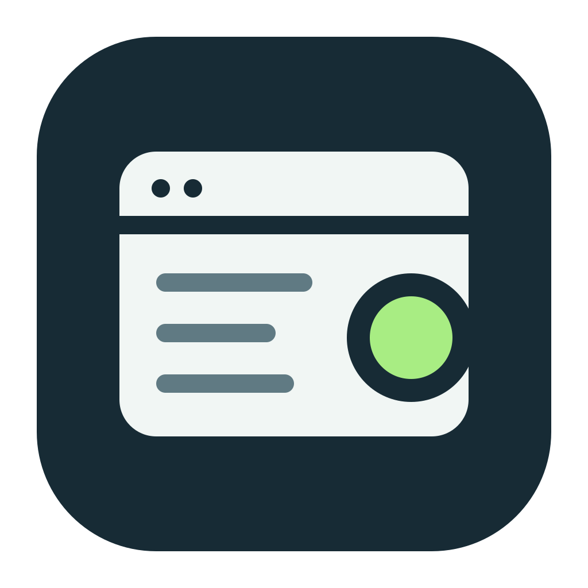

<p align="center"></p>

# Sideglance

**Your coding agents, at a glance.**

Running agents across several projects means checking several conversations for progress. Sideglance puts their reported updates in a compact desktop window, grouped by project and branch.

Pin it above your editor. See what agents are working on, what they've reported complete, and follow links to related work.

[Download the latest release](https://github.com/Vivek-Raman/Sideglance/releases/latest) · [Setup and technical reference](docs/technical-reference.md) · [Report an issue](https://github.com/Vivek-Raman/Sideglance/issues)

## Keep the work in view

- **One board across projects.** Scan agent updates grouped by project and Git branch.
- **A window that stays visible.** Enable always-on-top while you work in your editor.
- **Updates from your agents.** Connected agents publish and revise short reports through MCP.
- **Less clutter.** Dismiss updates, pin items you want to keep, or enable age/count-based cleanup. Recover automatically removed items from Recently removed.
- **Your preferred view.** Adjust theme, color, text size, and project order.

Status data stays on your machine. The bundled MCP server receives reports even when the window is closed.

## Get started

1. Download a desktop bundle for your platform from [Releases](https://github.com/Vivek-Raman/Sideglance/releases). Release builds target macOS, Windows, and Linux.
2. Install and open Sideglance, then open **Settings → Agent integration**.
3. Install the bundled skill and configure MCP for your agent. Codex and Claude Code both have setup support for these two steps.
4. Restart your agent client if needed to load its new configuration, then start a fresh conversation.
5. Ask your agent: "Use the sideglance skill to report this task in Sideglance."

Use **Test connection** in Agent integration to check a new MCP connection without publishing a report. Existing sessions still need a restart after updating.

Reporting requires a real session ID from the agent client. Configuration alone does not prove reporting works; confirm that your first update appears in the board.

## Installing on macOS

Download the `.dmg` from [Releases](https://github.com/Vivek-Raman/Sideglance/releases), open it, and drag Sideglance into Applications.

Sideglance is not signed with an Apple Developer ID or notarized by Apple. macOS may say the app is "damaged" and suggest moving it to the Trash.

If you downloaded this copy from this repository's official GitHub release, open Terminal and run:

```sh
xattr -rd com.apple.quarantine /Applications/Sideglance.app
```

Then open Sideglance again. This removes the download quarantine for Sideglance only, allowing it to open without Apple's normal first-launch verification. Only do this for a copy you trust.

## Agent integrations

Settings can install both the skill and MCP registration for Codex, Claude Code, Antigravity, and OpenCode. Cursor has MCP registration support; Gemini has skill installation support. These partial integrations require additional setup for reporting.

Sideglance shows what agents report. A visible update does not prove an agent is still running, and a completion mark is the agent's report of completion. Sideglance does not run or schedule agents.

## Upgrading from ctx-ppteer

Sideglance now uses `sideglance` for its executable, skill, MCP registration, and storage directories. On first use, existing status and settings files are copied from the old `ctx-ppteer` directories if the new files do not exist. Originals remain as backups; subsequent updates go only to Sideglance.

Quit the old app and stop its MCP processes before upgrading. Install Sideglance, then install the skill and configure MCP for each client in Settings. Skill installation disables the old skill by backing up its `SKILL.md`; MCP registration replaces the old server key. Restart your agent clients to load the new tools. Update any custom instructions to invoke `sideglance`.

The app identifier has changed, so operating-system window placement and permissions may need to be set again. The GitHub repository and its links retain the old name until the repository is renamed.

## Updates

Select **Check for updates** in Settings to look for a newer stable release. Sideglance downloads and verifies a signed update before installing it. Windows restarts through its installer. macOS and Linux ask you to restart Sideglance after installation.

The first macOS installation still needs the [quarantine command above](#installing-on-macos) because Sideglance is not notarized. The updater is designed to avoid repeating that command, but verify this on your macOS version before relying on it. Linux self-updates apply to the AppImage bundle. Installations managed by a package manager should update through that package manager.

## Development

Requires Node 24.11.1 or newer, npm, Rust, and the Tauri platform prerequisites. CI uses Rust 1.99.0.

```sh
npm ci
npx playwright install chromium
npm run dev
# Run verification separately from the development server:
npm run verify
cargo fmt --manifest-path src-tauri/Cargo.toml --check
cargo clippy --manifest-path src-tauri/Cargo.toml --locked --all-targets -- -D warnings
cargo test --manifest-path src-tauri/Cargo.toml --locked
```

Build a desktop bundle with `npm run tauri build`. See the [technical reference](docs/technical-reference.md) for the status schema, MCP contract, source layout, and motion checks.

## License

[GPL-3.0-only](LICENSE).
